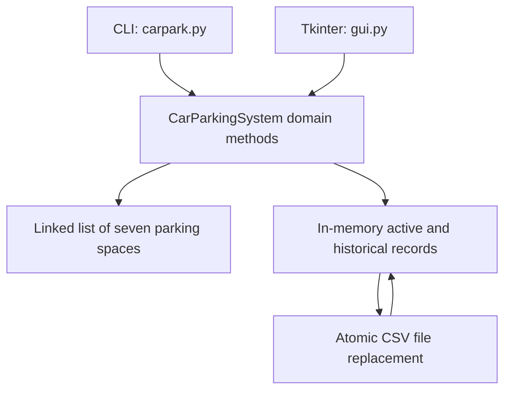

# Car parking desktop prototype: architecture and maintenance

Reviewed source: `b694ee19476e78ef89601732d083c4c4d3d4a97c`. Maintenance date: 11 November 2026. This document describes inspected code, the bounded fixes in this change and future work separately. It does not establish production deployment or measured scale. Original coursework/learning material and prior authorship remain identifiable; this maintenance was AI-assisted.

## Implemented architecture



| Component | Source | Responsibility |
| --- | --- | --- |
| CLI and domain logic | carpark.py | Entry, exit, registration checks, ticket lookup and fees. |
| Desktop view | gui.py | Tkinter callbacks use the shared parking-system class. |
| Persistence | parkingRecords.csv | Six-column local file; default path is now module-relative; an explicit path supports isolated tests. |

## Engineering decisions in this change

Only active records reserve a space. A full car park returns None rather than calling random.choice on an empty collection. Negative elapsed time cannot produce a negative fee. CSV writes use a flushed temporary file and atomic replacement to protect an existing file from partial writes.

## Reproduce checks and run

Run from the repository root with Python 3.12 or Node 22 as appropriate. Use a virtual environment before installing Python dependencies.

```bash
python -m unittest discover -s tests -v
```

6 regressions cover full capacity, historical releases, one free space, empty CSV, failed replacement preserving prior bytes and fee boundaries.

## Current boundaries

CSV replacement is atomic for one writer; it does not provide cross-process locking or a database transaction. GUI operations remain synchronous and duplicate some orchestration. This is a single-process, seven-space learning prototype, not a multi-site booking service. The registration check supports the modern UK example format only.

## Scaling path and acceptance evidence

Keep the current model for one local operator. Before concurrent operators, move occupancy into SQLite transactions with a unique constraint for active space and registration; use one service boundary for both views. Index historical tickets rather than scanning growing records. Measure allocation time and record-count memory before changing storage.

## Maintenance and recovery

Keep data and credentials out of source changes. Reproduce a failure with synthetic inputs before modifying a transformation or user action. Run the focused CI checks, review changes to input/output contracts and retain the prior commit for rollback. Back up local CSV/database inputs outside the working tree before manual runs. Revert the maintenance commit to roll back code; preserve data separately because reverting code does not reverse data mutations. Record environment versions, input schema, failure steps and expected/actual behavior in future bug reports.
